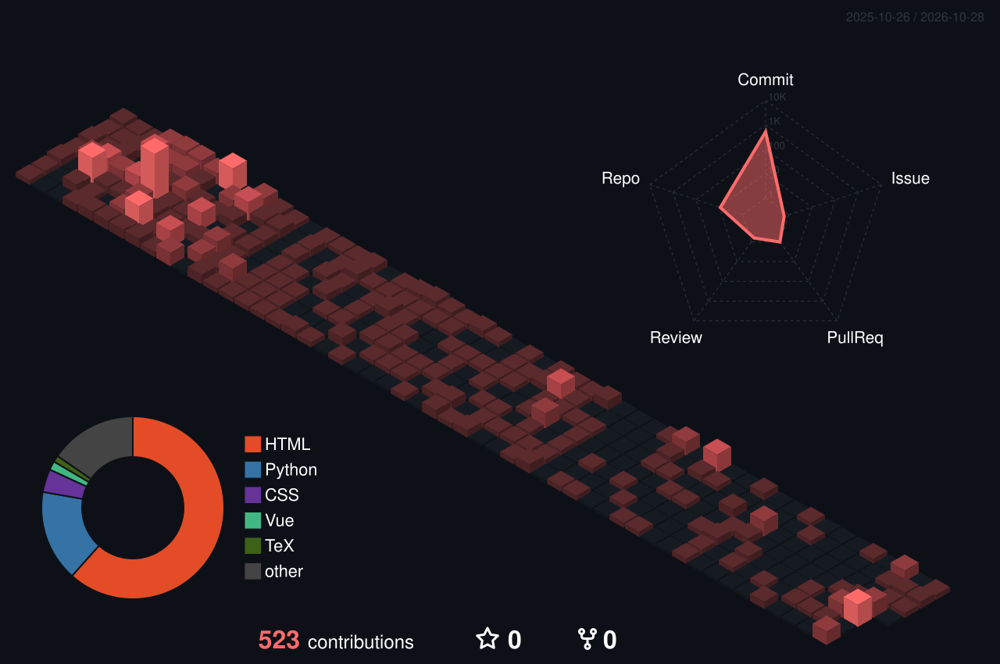

  

  

  

---

## 🎓 About Me

I am **Li Qinxuan (李沁轩)**, a third-year (junior) **Computer Science and Technology** student at **China University of Mining and Technology** 🏫

🎯 **My Focus Areas:**

- 🤖 **Multi-Agent Systems** — LLM-driven agent collaboration & orchestration
- 🔗 **RAG (Retrieval-Augmented Generation)** — knowledge-grounded LLM applications
- 👁️ **Computer Vision & Machine Learning**
- 🔢 **Algorithm Design**

🌱 **Currently:** building my own agent framework and exploring real-world AI deployments.

---

## 🏆 Honors & Awards

- 🥈 **ASC Student Supercomputer Challenge** — Global Second Prize · `Team Leader`
- 🥇 **China Collegiate Computing Contest (4C)** — Zhipu Industry Track · Agent Development Special Competition, **First Prize** (Featured Work 7/897) · `Team Leader`
- 🥈 **MCM/ICM (American Mathematical Modeling Contest)** — H Award (Second Prize) · `Team Leader`
- 🥉 **"Challenge Cup" Unveiling-the-List Arena Contest** — High-End Equipment Track, Third Prize
- 🥇 **Jiangsu "May 1st" Mathematical Modeling Contest** — First Prize · `Team Leader`
- 🥈 **Jiangsu Market Survey & Analysis Competition** — Second Prize · `Second Lead`
- 🥈 **Jiangsu Energy Conservation & Emission Reduction Competition** — Second Prize · `Second Lead`
- 🥉 **China International College Students' Innovation Competition** — Jiangsu Division Third Prize · Campus-Level Grand Prize · `Leader`
- 🎖️ **Xiaomi First-Class Scholarship** — 1/379

---

## 💻 Tech Stack & Skills

### 🚀 Languages

### 🛠️ Tools & Environment

![OpenAI Codex](https://img.shields.io/badge/OpenAI%20Codex-412991?style=for-the-badge&logo=data:image/svg%2bxml;base64,PHN2ZyB4bWxucz0iaHR0cDovL3d3dy53My5vcmcvMjAwMC9zdmciIHdpZHRoPSIwLjk5ZW0iIGhlaWdodD0iMWVtIiB2aWV3Qm94PSIwIDAgMjU2IDI2MCI+PHBhdGggZD0iTTIzOS4xODQgMTA2LjIwM2E2NC43MiA2NC43MiAwIDAgMC01LjU3Ni01My4xMDNDMjE5LjQ1MiAyOC40NTkgMTkxIDE1Ljc4NCAxNjMuMjEzIDIxLjc0QTY1LjU4NiA2NS41ODYgMCAwIDAgNTIuMDk2IDQ1LjIyYTY0LjcyIDY0LjcyIDAgMCAwLTQzLjIzIDMxLjM2Yy0xNC4zMSAyNC42MDItMTEuMDYxIDU1LjYzNCA4LjAzMyA3Ni43NGE2NC42NyA2NC42NyAwIDAgMCA1LjUyNSA1My4xMDJjMTQuMTc0IDI0LjY1IDQyLjY0NCAzNy4zMjQgNzAuNDQ2IDMxLjM2YTY0LjcyIDY0LjcyIDAgMCAwIDQ4Ljc1NCAyMS43NDRjMjguNDgxLjAyNSA1My43MTQtMTguMzYxIDYyLjQxNC00NS40ODFhNjQuNzcgNjQuNzcgMCAwIDAgNDMuMjI5LTMxLjM2YzE0LjEzNy0yNC41NTggMTAuODc1LTU1LjQyMy04LjA4My03Ni40ODNtLTk3LjU2IDEzNi4zMzhhNDguNCA0OC40IDAgMCAxLTMxLjEwNS0xMS4yNTVsMS41MzUtLjg3bDUxLjY3LTI5LjgyNWE4LjYgOC42IDAgMCAwIDQuMjQ3LTcuMzY3di03Mi44NWwyMS44NDUgMTIuNjM2Yy4yMTguMTExLjM3LjMyLjQwOS41NjN2NjAuMzY3Yy0uMDU2IDI2LjgxOC0yMS43ODMgNDguNTQ1LTQ4LjYwMSA0OC42MDFNMzcuMTU4IDE5Ny45M2E0OC4zNSA0OC4zNSAwIDAgMS01Ljc4MS0zMi41ODlsMS41MzQuOTIxbDUxLjcyMiAyOS44MjZhOC4zNCA4LjM0IDAgMCAwIDguNDQxIDBsNjMuMTgxLTM2LjQyNXYyNS4yMjFhLjg3Ljg3IDAgMCAxLS4zNTguNjY1bC01Mi4zMzUgMzAuMTg0Yy0yMy4yNTcgMTMuMzk4LTUyLjk3IDUuNDMxLTY2LjQwNC0xNy44MDNNMjMuNTQ5IDg1LjM4YTQ4LjUgNDguNSAwIDAgMSAyNS41OC0yMS4zMzN2NjEuMzlhOC4yOSA4LjI5IDAgMCAwIDQuMTk1IDcuMzE2bDYyLjg3NCAzNi4yNzJsLTIxLjg0NSAxMi42MzZhLjgyLjgyIDAgMCAxLS43NjcgMEw0MS4zNTMgMTUxLjUzYy0yMy4yMTEtMTMuNDU0LTMxLjE3MS00My4xNDQtMTcuODA0LTY2LjQwNXptMTc5LjQ2NiA0MS42OTVsLTYzLjA4LTM2LjYzTDE2MS43MyA3Ny44NmEuODIuODIgMCAwIDEgLjc2OCAwbDUyLjIzMyAzMC4xODRhNDguNiA0OC42IDAgMCAxLTcuMzE2IDg3LjYzNXYtNjEuMzkxYTguNTQgOC41NCAwIDAgMC00LjQtNy4yMTNtMjEuNzQyLTMyLjY5bC0xLjUzNS0uOTIybC01MS42MTktMzAuMDgxYTguMzkgOC4zOSAwIDAgMC04LjQ5MiAwTDk5Ljk4IDk5LjgwOFY3NC41ODdhLjcyLjcyIDAgMCAxIC4zMDctLjY2NWw1Mi4yMzMtMzAuMTMzYTQ4LjY1MiA0OC42NTIgMCAwIDEgNzIuMjM2IDUwLjM5MXpNODguMDYxIDEzOS4wOTdsLTIxLjg0NS0xMi41ODVhLjg3Ljg3IDAgMCAxLS40MS0uNjE0VjY1LjY4NWE0OC42NTIgNDguNjUyIDAgMCAxIDc5Ljc1Ny0zNy4zNDZsLTEuNTM1Ljg3bC01MS42NyAyOS44MjVhOC42IDguNiAwIDAgMC00LjI0NiA3LjM2N3ptMTEuODY4LTI1LjU4TDEyOC4wNjcgOTcuM2wyOC4xODggMTYuMjE4djMyLjQzNGwtMjguMDg2IDE2LjIxOGwtMjguMTg4LTE2LjIxOHoiLz48L3N2Zz4=)
![ZCode · GLM](https://img.shields.io/badge/ZCode%20%C2%B7%20GLM-2563EB?style=for-the-badge&logo=data:image/svg%2bxml;base64,PHN2ZyB4bWxucz0iaHR0cDovL3d3dy53My5vcmcvMjAwMC9zdmciIHdpZHRoPSIxZW0iIGhlaWdodD0iMWVtIiB2aWV3Qm94PSIwIDAgMjQgMjQiPjxwYXRoIGZpbGw9IiNmZmZmZmYiIGZpbGwtcnVsZT0iZXZlbm9kZCIgZD0iTTExLjkgMjMuNWEuMjQuMiAwIDAgMC0uMjQ0LjJhLjI0LjIgMCAwIDAgLjI0NC4yYS4yNC4yIDAgMCAwIC4yNDUtLjI0OWEuMjQuMiAwIDAgMC0uMjItLjI0N3pNOS42IDUuM2ExLjYgMS42IDAgMCAxIDEgMi4xbC0uMDcxLjFsLS4wMTZsLS4wMThjLS4wNy4xLS4xMDQuMy0uMTA0LjRjLS4wMzUuNy40NyAxLjIgMS4xIDEuM2guMzY2YzEuMy4wNTMgMi4zIDEuMSAyLjIgMi41Yy0uMDUyIDEuMy0xLjEgMi4zLTIuNCAyLjNoLS4xNzRjLS43MTUtMS4yLjY0LTEuMiAxLjNjMCAuMTI0LjIzLjMzN2MuMjA5LjMuNTQuNi45Ni44Yy43NS4yIDEuNS0uMTI1IDEuOS0uNzgybC4wMTgtLjAzNWMuNDAyLS42NCAxLjEtLjk2IDEuOS0uNzExYy44NTQuMiAxLjMgMS4yIDEgMi4xYTEuNiAxLjYgMCAwIDEtMiAxLjFhMS43IDEuNyAwIDAgMS0uOTA3LS43MTFsLS4wMTctLjAzNWMtLjItLjMyMy0uNDYzLS41OC0uODUxLS43MTFsLS4wNTYtLjAxOGExLjYgMS42IDAgMCAwLTEuOS43NDZhMS42IDEuNiAwIDAgMS0xLjc2NGExLjYgMS42IDAgMCAxLTEuOS0xLjJjLS4yMDktLjkwNi4zLTEuOCAxLjItMmExLjUgMS41IDAgMCAxIC4yOTYtLjAzNWguMDE4Yy42OC0uMDcxIDEuMS0uNjIyIDEuMS0xLjNhMS4zIDEuMyAwIDAgMC0uMjI3LS42OTNhMi41IDIuNSAwIDAgMS0uMzY2LTEuNGEyLjQgMi40IDAgMCAxIC4zNjYtMS4yYy4xNC0uMTk1LjItLjQ0NC4yLS42OTNjLjAxOC0uNzEtLjUwNi0xLjItMS4xLTEuM2wtLjA3LS4wMThhMS40IDEuNCAwIDAgMS0uMjk5LS4wN2wtLjA1LS4wMTlhMS43IDEuNyAwIDAgMS0xLTIuMWExLjYgMS42IDAgMCAxIDItMS4xbS01LjUgMTAuMWMuMjYtLjI2NC42LS4zNjcuOS0uMjdzLjYzMy4zLjcyOC43Yy4wOTUuMy0uMDA3LjctLjI2NyAxYy0uNDAyLjQtMS40MS0xLjQgMGExIDEgMCAwIDEgMC0xLjR6bTE0LjgtLjI5NGMuMzU5LS4wOS43LjAyNC45LjI5N2MuMjU0LjIuMzQ0LjYuMjM3IDFzLS4zOTYuNi0uNzU2LjdjLS41NTEuMS0xLjEtLjIyLTEuMi0uNzgxYTEgMSAwIDAgMSAuNzU3LTEuMnptLS4wNjQtNC4zYy4zMTQuMy40OS43LjQ5IDEuMnMtLjE3Ni44LS40OSAxLjJjLS4zMTUuMy0uNzQuNS0xLjEuNWMtLjQ0NCAwLS44Ny0uMTgtMS4xLS41YTEuNyAxLjcgMCAwIDEgMC0yLjRhMS42IDEuNiAwIDAgMSAyLjMgMG0tMTEuMi4xNjNjLjM2NC40LjQ0NyAxLjEuMjE4IDEuNmExLjYgMS42IDAgMCAxLTIuMS45MjNjLS44NTUtLjM2LTEuMi0xLjMtLjkwNy0yLjJhMS42IDEuNiAwIDAgMSAxLjMtMWExLjYgMS42IDAgMCAxIDEuNS42NTJtMTEuNS00LjJjLjM2OCAwIC43MDguMi44LjUyNHMuMTg0LjcgMCAxYTEgMSAwIDAgMS0uODkyLjVhMSAxIDAgMCAxLTEtMWExIDEgMCAwIDEgMS0xbS0xNC4zIDBjLjM2OCAwIC43MDcuMi44LjUyNHMuMTg0LjcgMCAxYTEgMSAwIDAgMS0uODkxLjVhMSAxIDAgMCAxLTEtMWMwLS41NzkuNC0xIDEtMW0xMC0xLjRjLjkyNSAwIDEuNi43NjQgMS42IDEuN3MtLjc1IDEuNy0xLjYgMS43cy0xLjYtLjc2My0xLjYtMS43cy43NS0xLjcgMS42LTEuN20tMi42LS42ODRjLjM2Mi0uMDgyLjYtLjM1Ni43LS43MThhMSAxIDAgMCAwLS4yMzgtMWExIDEgMCAwIDAtLjk5Ni0uMjk0Yy0uNTQ3LjEtLjg4MS43LS43NTIgMS4yYy4xMy41LjY3NS45IDEuMi43ODNtMCAxNi44Yy4zNTktLjA4Ny42LS4zNi43LS43MmExIDEgMCAwIDAtLjIzNy0xYTEgMSAwIDAgMC0uOTg1LS4zMDFhMSAxIDAgMCAwLS43NjIuN2MtLjEwOC4zLS4wMTcuNy4yMzkgMWMuMjQ1LjIuNjA2LjMuOTUzLjN6TTE3LjEgMy41YS42My42IDAgMCAwIC42MjgtLjY0YS42My42IDAgMCAwLS42MjgtLjY0YS42My42IDAgMCAwLS42MjguNmMwIC4zNTUuMi42NC42LjY0bS0xMC4zIDBhLjYzLjYgMCAwIDAgLjYyOC0uNjRjMC0uMzU1LS4yOC0uNjQtLjYyOC0uNjRhLjYzLjYgMCAwIDAtLjYyOC42YzAgLjM1NS4yLjY0LjYuNjRtLTUuMSA3LjhhLjYzLjYgMCAwIDAtLjYyOC42YzAgLjM1NC4yLjYzOS42LjYzOWEuNjMuNiAwIDAgMCAuNjI3LS42MDZsLjAwMS0uMDM0YS42Mi42IDAgMCAwLS42MjgtLjY0em01LjEgOS4xYS42My42IDAgMCAwLS42MjguNmMwIC4zNTUuMi42NC42LjY0YS42My42IDAgMCAwIC42MjgtLjY0YzAtLjM1NS0uMjgtLjY0LS42MjgtLjY0bTEwLjMuMDE4YS42My42IDAgMCAwLS42MjguNmMwIC4zNTUuMi42NC42LjY0YS42My42IDAgMCAwIC42MjgtLjY0YS42My42IDAgMCAwLS42MjgtLjY0bTUuMS05LjFhLjYzLjYgMCAwIDAtLjYyOC42YzAgLjM1NC4yLjYzOS42LjYzOWEuNjMuNiAwIDAgMCAuNjI4LS42NGMwLS4zNTUtLjI4LS42NC0uNjI4LS42NHptLS4zODQtNC45YS4yNC4yIDAgMCAwIC4yNDQtLjI0OWEuMjQuMiAwIDAgMC0uMjQ0LS4yNDlhLjI0LjIgMCAwIDAtLjI0NC4yYzAgLjE0Mi4xLjI0OS4yLjI0OU0xMS45LjQ5N2EuMjQuMiAwIDAgMCAuMjQ1LS4yNDhBLjI0LjIgMCAwIDAgMTEuOSAwYS4yNC4yIDAgMCAwLS4yNDQuMmMwIC4xMzMuMS4yMzYuMi4yNDd6TTIgNi4zYS4yNC4yIDAgMCAwIC4yNDUtLjI0OWEuMjQuMiAwIDAgMC0uMjQ0LS4yNDlhLjI0LjIgMCAwIDAtLjI0NC4yYS4yNC4yIDAgMCAwIC4yNDQuMnptMCAxMS4yYS4yNC4yIDAgMCAwLS4yNDMuMmEuMjQuMiAwIDAgMCAuMjQ0LjJhLjI0LjIgMCAwIDAgLjI0NC0uMjQ5YS4yNS4yIDAgMCAwLS4yNDQtLjI0OHptMTkuOS0uMDE4YS4yNC4yIDAgMCAwLS4yNDUuMmEuMjQuMiAwIDAgMCAuMjQ1LjJhLjI0LjIgMCAwIDAgLjI0NC0uMjVhLjI1LjIgMCAwIDAtLjI0NC0uMjQ4Ii8%2BPC9zdmc%2B)

### 🤖 AI / ML & Agent Frameworks

---

## 📊 GitHub Analytics

  

  
  
  

  

  

---

## 🌐 Connect With Me

📧 **Email:**

- 🏫 Academic: `08241120@cumt.edu.cn`
- 🌐 Personal: `richardli.11.02.06@gmail.com`
- 💬 QQ: `3222482537@qq.com`

📝 **Blog & Social:**

- 

🔗 **Let's Connect:**

  
  

---

## 💬 Quote of the Day

  

  

