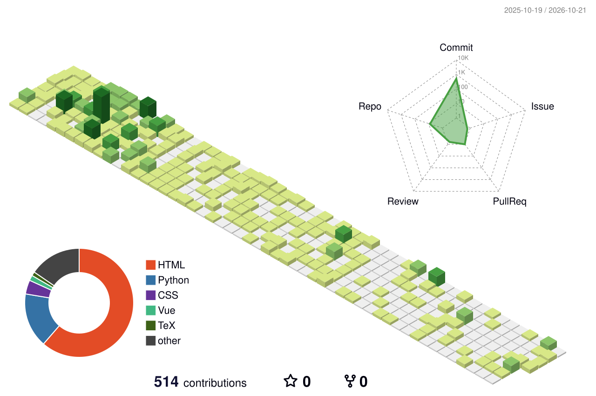

  

  

  

---

## 🎓 About Me

I am **Li Qinxuan (李沁轩)**, a third-year (junior) **Computer Science and Technology** student at **China University of Mining and Technology** 🏫

🎯 **My Focus Areas:**

- 🤖 **Multi-Agent Systems** — LLM-driven agent collaboration & orchestration
- 🔗 **RAG (Retrieval-Augmented Generation)** — knowledge-grounded LLM applications
- 👁️ **Computer Vision & Machine Learning**
- 🔢 **Algorithm Design**

🌱 **Currently:** building my own agent framework and exploring real-world AI deployments.

---

## 🏆 Honors & Awards

- 🥈 **ASC Student Supercomputer Challenge** — Global Second Prize · `Team Leader`
- 🥇 **China Collegiate Computing Contest (4C)** — Zhipu Industry Track · Agent Development Special Competition, **First Prize** (Featured Work 7/897) · `Team Leader`
- 🥈 **MCM/ICM (American Mathematical Modeling Contest)** — H Award (Second Prize) · `Team Leader`
- 🥉 **"Challenge Cup" Unveiling-the-List Arena Contest** — High-End Equipment Track, Third Prize
- 🥇 **Jiangsu "May 1st" Mathematical Modeling Contest** — First Prize · `Team Leader`
- 🥈 **Jiangsu Market Survey & Analysis Competition** — Second Prize · `Second Lead`
- 🥈 **Jiangsu Energy Conservation & Emission Reduction Competition** — Second Prize · `Second Lead`
- 🥉 **China International College Students' Innovation Competition** — Jiangsu Division Third Prize · Campus-Level Grand Prize · `Leader`
- 🎖️ **Xiaomi First-Class Scholarship** — 1/379

---

## 💻 Tech Stack & Skills

### 🚀 Languages

### 🛠️ Tools & Environment

### 🤖 AI / ML & Agent Frameworks

---

## 📊 GitHub Analytics

  

  
  
  

  

  

---

## 🌐 Connect With Me

📧 **Email:**

- 🏫 Academic: `08241120@cumt.edu.cn`
- 🌐 Personal: `richardli.11.02.06@gmail.com`
- 💬 QQ: `3222482537@qq.com`

📝 **Blog & Social:**

- 

🔗 **Let's Connect:**

  
  

---

## 💬 Quote of the Day

  

